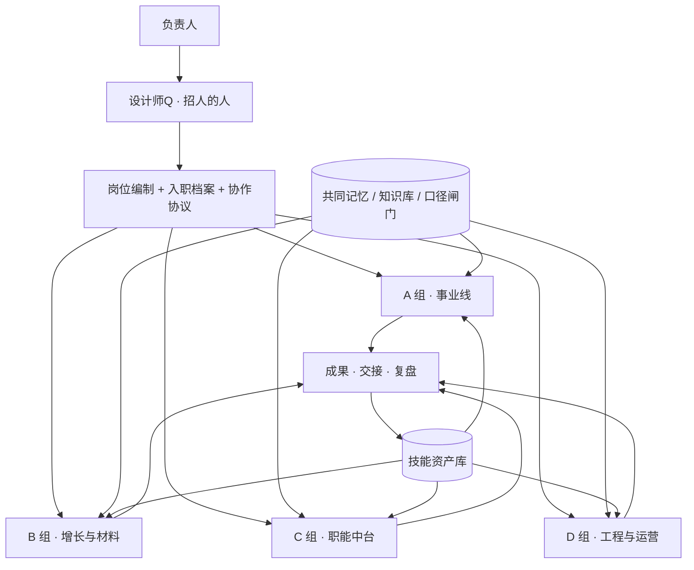

# 弘矩阵 · AI 员工体系


> **把 AI 当员工，而不是当工具。**

这里记录弘矩阵正在做的一件事：不给 AI 排一串待办，而是给它**岗位、入职档案、共同记忆、协作规则和交接本**，让它能长期负责一块事业。

三条事业线交汇在同一个目标上——**用 AI 赋能并建设工厂**：AI 事业打底座，AI 农业做循环水养殖与绿色种植，AI 生物制造围绕肽与天然提取物做研究与产业化，再由商业化能力把技术变成能谈、能建、能运营的方案。

> **关于本页**：这是**公开的脱敏介绍页**，不含经营数据、客户与合作方、工艺参数、项目所在地、内部路径、账号与凭据。完整实现（脚本、参数、内部流程）保存在私有资产库，不对外公开。

---

## 一、为什么不是「多用几个 AI 工具」

工具越多，人越像传话筒。我们的判断是：**缺的不是能力，是组织层。**

| | 把 AI 当工具 | 把 AI 当员工 |
|---|---|---|
| 每次开始 | 重新交代背景 | 读同一份公司记忆，直接接上下文 |
| 责任边界 | 「帮我写一下」 | 岗位说明书 + 一句话职责 + 验收标准 |
| 协作方式 | 人搬运结果 | 先提方案、确认后动手，完工写交接 |
| 出错时 | 换个提示词重试 | 回查口径闸门与验收线，改流程不改人 |
| 干得好之后 | 对话结束即消失 | 沉淀成技能，进资产库，可复用可回滚 |

一句话：**同一批能力，补上组织层，才从「工具」变成「员工」。**

---

## 二、三条事业线

| 事业线 | 在做什么 | 能力形态 | 典型产出 |
|---|---|---|---|
| **AI 事业** | 让算力、物联网与内容生产成为工厂的基础设施 | 分布式算力调度、设备与产线感知、视频与内容流水线 | 运行方案、感知看板、内容资产 |
| **AI 农业** | 用数据与自动化经营循环水养殖与绿色种植 | 环境感知、生产节拍管理、异常预警、批次追溯 | 养殖/种植运营方案、数据标准、作业手册 |
| **AI 生物制造** | 围绕肽与天然提取物做研究与产业化 | 结构预测、提取路线比对、质量口径、原料到产品 | 研究简报、工艺路线说明、原料与产品档案 |

**商业化**是横在三条线之上的能力：把技术变成能谈、能建、能运营的方案，再变成可交付的材料包与产品。

<details>
<summary>一个容易踩的坑：能力强 ≠ 可以直接对外</summary>

三条线各自都有「内部说法」和「对外说法」。任何数字、案例、主体名称在对外材料里出现前，都要过一遍**权威口径闸门**；口径未裁决时宁可留白，不许让 AI 自行取值。这条规则写进了每个岗位的入职档案。

</details>

---

## 三、体系怎么搭起来



- **先有招人的人**：由「设计师Q」先盘清公司的项目与任务，再捏出专门岗位，而不是一上来堆十几个半吊子。
- **编制有上限**：四组岗位覆盖事业线、增长与材料、职能中台、工程与运营；**批量产出，分批上岗**，先精调少数岗位再扩编。
- **不新增管理层级**：岗位复用同一套技能底座，只是角色边界不同。

---

## 四、七步法 → 落地机制

| # | 方法 | 落在这个体系的哪里 |
|---|---|---|
| 一 | 让 AI 造 AI | 设计师Q：先出《项目与任务盘点表》，确认后才生成岗位 |
| 二 | 不在多而在精 | 编制封顶、分批放行、试岗打分留用 |
| 三 | 当实习生带 | 入职档案五件套；首个任务**只交方案，不动手** |
| 四 | 沉淀技能 | 复用、可交接、有验收，三条齐了才写进技能库 |
| 五 | 配邮箱和账号 | 平台邮箱能力当工牌，按岗位分配对外身份 |
| 六 | 别当传话筒 | 一旦要手动搬信息，就停下来改成自动流程 |
| 七 | 语音下指令 | 长指令先复述确认，确认前只做只读动作 |

---

## 五、一天怎么运转

| 时刻 | 发生什么 | 留下的东西 |
|---|---|---|
| 开机 | 自动生成当日任务文档，延续未完成项与卡点 | 当日任务清单 |
| 分工 | 按岗位分组派活，标注在岗状态 | 分工表 |
| 动手前 | 岗位先提方案，等人确认 | 方案提报 |
| 执行中 | 引用共同记忆与口径闸门，成果落到任务文件夹 | 成果文件 |
| 收工 | 写交接记录：做了什么、落点在哪、谁复核 | 交接记录 |
| 干得好 | 方法写成技能 → 扫描 → 提交 → 推送资产库 | 一次可回溯的沉淀 |

> 只有**成果文档**才做正式版式交付；过程稿、台账、岗位卡、每日文档一律保持轻量 Markdown。

---

## 六、简洁技能卡

本仓 [`skills/`](skills/README.md) 收录 8 张**脱敏简洁技能卡**：一张卡讲清一个能力，按「可公开」标准撰写，换个行业把场景词替换掉就能用。完整实现（脚本、参数、内部流程）另存于私有资产库，不在本仓。

| 能力 | 一句话 |
|---|---|
| [把 AI 当员工：入职包](skills/01-ai-employee-onboarding.md) | 从岗位说明书到验收标准，捏出一个能长期负责的员工 |
| [共同记忆与口径闸门](skills/02-company-memory.md) | 让所有岗位读同一份上下文，数字引用前先过闸门 |
| [AI 循环水养殖与绿色种植](skills/03-digital-agriculture.md) | 把环境感知、生产节拍与批次追溯变成可运营方案 |
| [肽与提取物研究](skills/04-bio-manufacturing.md) | 结构预测、路线比对、质量口径与原料档案 |
| [算力与工厂物联网](skills/05-compute-and-iot.md) | 让本地算力与设备感知成为产线的基础设施 |
| [视频与内容生产线](skills/06-content-production.md) | 从创意简报到分镜、成片与质检的流水线 |
| [对外材料编写](skills/07-business-materials.md) | 计划书、可研、演示、合同等成果材料的统一打法 |
| [技能沉淀与同步](skills/08-skill-deposit.md) | 干得好就存成技能，扫描后推资产库 |

每张卡固定六段：**何时用 / 输入 / 输出 / 做法 / 验收 / 不做什么**，缺一段不算合格。

---

## 七、安全边界

本页与 `skills/` 按「可公开」标准撰写，**明确不含**：

- 财务、投资、营收、利润、回报率等经营数据
- 产能、亩产、单位产出等生产指标
- 知识产权数量、检测数值、工艺参数与配方
- 客户、合作方、专家姓名、项目所在地与投资额
- 本机路径、内部文件名、账号、邮箱、密钥与授权码

其余底线：

1. **明文凭据零落盘**：授权交给系统凭据管理器，token 不进文件、不进 URL、不进日志。
2. **推前双重扫描**：密钥扫描 + 脱敏自检；任一不过，拒绝提交与推送。
3. **数字不自行取值**：所有对外数字回查内部权威口径，口径未裁决则留白。
4. **技能本体与副本分离**：改能力改本体，副本由同步器生成。
5. **公开与私有分层**：公开区只放方法论与简洁卡，实现细节一律留在私有仓。

---

## 八、快速开始

```bash
git clone https://github.com/cdcoffee/cdcoffee.git
cd cdcoffee
```

三步上手：

1. 从 [`skills/README.md`](skills/README.md) 挑一张卡，看「何时用 / 输入 / 输出 / 验收」四段。
2. 按自己的业务替换场景词，套用统一模板写成新卡。
3. 跑一次脱敏自检，通过后同步，让方法变成可复用资产。

> 想看体系方法，从 [`skills/01`](skills/01-ai-employee-onboarding.md) 与 [`skills/02`](skills/02-company-memory.md) 开始。

---

## 九、路线图

| 阶段 | 主题 | 状态 |
|---|---|---|
| 组织层 | 岗位编制、入职档案、协作协议、共同记忆 | 已落地 |
| 知识层 | 可迭代知识库与权威口径闸门 | 已落地 |
| 沉淀层 | 技能库、密钥扫描、私有仓同步 | 已落地 |
| 排班层 | 开机自动生成当日任务 | 已落地 |
| 试岗层 | 首批岗位试岗与方案提报 | 进行中 |
| 扩编层 | 按批次放行其余岗位 | 待启动 |
| 交付层 | 成果材料流水线与版式规则 | 待启动 |

---

## 十、关于

- **性质**：公开的脱敏介绍页 + 简洁技能卡；实现资产保持私有。
- **维护方式**：AI 员工每干成一件可复用的活，就把方法写成技能，经扫描与审阅后沉淀。
- **协作**：欢迎就「把 AI 当员工」的方法论提 Issue 交流；对外材料一律走口径闸门复核。
- **一句话**：**工具会过时，组织会积累。**
